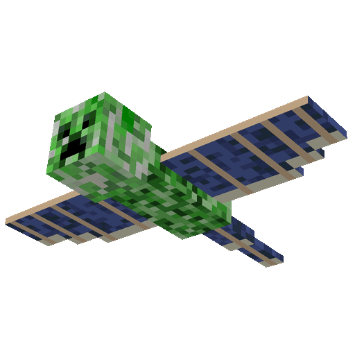
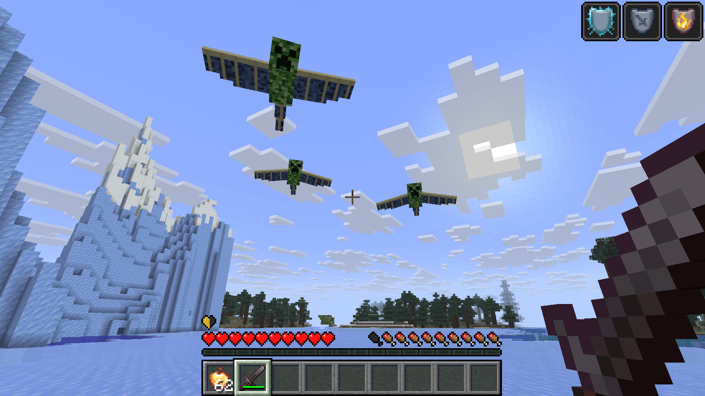
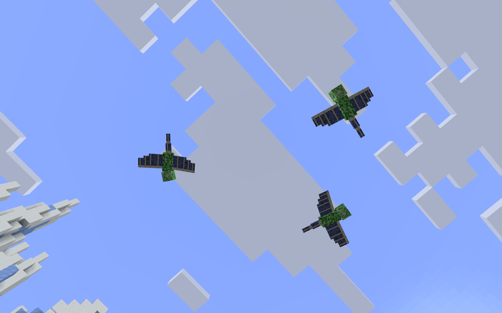
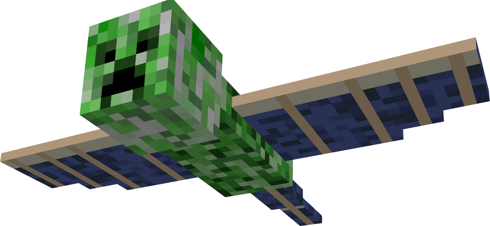

# PhantomCreeper

<p align="center">
  
</p>

<p align="center">
  <a href="#compatibility"></a>
  <a href="#compatibility"></a>
  <a href="#compatibility"></a>
  <a href="#compatibility"></a>
  <a href="#compatibility"></a>
  <a href="#compatibility"></a>
  <a href="https://bstats.org/plugin/bukkit/PhantomCreeper/35223"></a>
  <a href="https://github.com/che11111/PhantomCreeper/blob/main/LICENSE"></a>
</p>

<p align="center"><b>English</b> · <a href="https://github.com/che11111/PhantomCreeper/blob/main/README-zh.md">简体中文</a></p>

PhantomCreeper is a hybrid Phantom and Creeper mob. It flies like a Phantom, approaches players, and then primes and explodes like a Creeper. The plugin supports Paper and Folia and can render the model with BetterModel or ModelEngine 4.x.

<table align="center">
  <tr>
    <td align="center"></td>
    <td align="center"></td>
  </tr>
</table>

## Compatibility

- Server: Paper or Folia 26.1.x–26.3.
  (Tested on Paper 26.3 and Folia 26.3; other versions have not been tested.)
- Java: 25 required. The plugin is not compatible with Java 21.
- Model engine (choose one):
  - BetterModel 3.6.0 or newer (the reference version for this project is 3.7.0).
  - ModelEngine 4.1.1 or newer (Free and Premium are both supported).
- Resource-pack hosting: CraftEngine, ItemsAdder, or another plugin capable of merging model-engine resources.

> Known issue: Model flight currently has slight stuttering under ModelEngine. Flight is smooth under BetterModel. This issue has not yet been fixed.

## Commands

| Command | Description |
| --- | --- |
| `/phantomcreeper stats` | View your own kill and death statistics |
| `/phantomcreeper spawn [player]` | Spawn 12 blocks ahead of and 6 blocks above a player |
| `/phantomcreeper removeall` | Remove every mob managed by this plugin |
| `/phantomcreeper reload` | Reload the configuration and language files |
| `/phantomcreeper info` | View the living count and model status |
| `/phantomcreeper engine <bettermodel\|modelengine>` | Switch the installed model engine at runtime and rebind existing mobs |

Alias: `/pcreeper`

Permissions:

- `phantomcreeper.stats`: Allows `/phantomcreeper stats`; available to all players by default.
- `phantomcreeper.admin`: Allows `spawn`, `removeall`, `reload`, `info`, and `engine`; OP only by default.

The `engine` subcommand is an administrator debugging command and is available only when the selected model-engine plugin is installed. Switching does not modify `config.yml`; after a server restart, the configured backend is used again.

## PlaceholderAPI Variables

| Variable | Description |
| --- | --- |
| `%phantomcreeper_kills%` | The player's PhantomCreeper kills in the current PlaceholderAPI player context |
| `%phantomcreeper_deaths%` | The number of times the player has been killed by a PhantomCreeper explosion |

Both variables are player-specific and return `0` when no player context is available.

## Full Configuration

Bundled languages are English, Simplified Chinese, Japanese, Korean, Traditional Chinese, German, French, Spanish, and Russian. The complete `config.yml` is shown below:

```yaml
# Restart the server after changing model settings; other settings can use /phantomcreeper reload.

# Plugin language: auto, or a file name under lang/ such as zh_cn.yml.
# auto follows the server Locale and falls back to en_us.yml when unrecognized.
language: auto

model:
  # Renderer backend: auto, bettermodel, or modelengine.
  # auto prefers BetterModel and automatically uses ModelEngine when BetterModel is absent.
  engine: auto
  # Shared model name for both model engines; normally no change is needed.
  name: phantom_creeper
  # Overall model scale multiplier.
  scale: 1.25
  # Looping wing-flap animation name used while flying.
  flap-animation: flap
  # With ModelEngine, install the bundled compatible blueprint to
  # plugins/ModelEngine/blueprints/phantom_creeper.bbmodel automatically.
  modelengine-auto-install-blueprint: true
  # Keep the vanilla Creeper carrier visible as a fallback when the model is unavailable.
  keep-base-phantom-visible-if-model-fails: true

targeting:
  # Maximum distance at which the creature starts tracking a player.
  acquire-range: 48.0
  # Drop the current target after it moves beyond this distance.
  lose-range: 64.0
  # Whether to ignore players in Creative mode.
  ignore-creative: true
  # Whether to ignore players in Spectator mode.
  ignore-spectator: true
  # Require an unobstructed line of sight; enabling this increases visibility-check cost.
  require-line-of-sight: false

movement:
  # Long-range cruise speed in blocks per tick; 0.32 is about 6.4 blocks per second.
  cruise-speed: 0.32
  # Close-range chase speed in blocks per tick.
  chase-speed: 0.48
  # Hard upper limit for all flight speeds.
  max-speed: 0.68
  # Velocity smoothing factor from 0.0 to 1.0; larger values turn faster.
  acceleration: 0.20
  # Cruise height above the target during long-range movement.
  cruise-height: 6.0
  # Strike height above the target's feet during a close-range dive.
  strike-height: 1.2
  # Horizontal distance for entering close attack mode and chase speed.
  close-range: 8.0
  # Orbit radius around the patrol point when no target is available.
  waypoint-radius: 3.5
  # Maximum distance from the initial spawn point while flying or returning home.
  max-distance-from-home: 72.0
  # Preferred separation distance between creatures; spawning at the same position is still allowed.
  minimum-separation: 6.0

combat:
  # Maximum health of PhantomCreeper.
  max-health: 24.0
  # Player distance required to start the explosion fuse.
  trigger-radius: 2.8
  # Fuse duration in ticks; 20 ticks equals one second.
  fuse-ticks: 30
  # Cancel the fuse and resume chasing when the player leaves this radius.
  fuse-cancel-radius: 7.0

  explosion:
    # Explosion radius in blocks; internally converted to Minecraft explosion power.
    radius: 6.0
    # Raw center damage before armor, enchantments, and damage immunity are applied.
    damage: 40.0
    # Whether damage falls off with distance; when disabled, full damage applies in range.
    damage-falloff: true
    # Whether the explosion may break blocks; disabled by default.
    break-blocks: false
    # Whether the explosion creates fire.
    set-fire: false
    # Whether the explosion may damage PhantomCreeper itself.
    damage-self: false

  # Number of Phantom Membranes dropped when killed by a player.
  drop-phantom-membrane: 2
  # Amount of gunpowder dropped when killed by a player.
  drop-gunpowder: 2
  # Minimum experience dropped when killed.
  dropped-experience: 20

natural-spawn:
  # Whether natural spawning is enabled.
  enabled: true
  # Interval between spawn-condition checks; 20 ticks equals one second.
  check-interval-ticks: 200
  # Minecraft night start time.
  night-start-time: 13000
  # Minecraft night end time.
  night-end-time: 23000
  # Whether natural spawning is limited to the Overworld.
  only-overworld: true
  # Maximum living naturally spawned creatures; admin spawning does not count toward this limit.
  max-active: 10
  # Global hard limit for all living creatures, including admin-spawned creatures.
  max-tracked: 20

  spawn-area:
    # Minimum horizontal distance from the player when choosing a spawn point.
    min-distance: 18.0
    # Maximum horizontal distance from the player when choosing a spawn point.
    max-distance: 32.0
    # Minimum height offset above the player when choosing a spawn point.
    min-height-offset: 6.0
    # Maximum height offset above the player when choosing a spawn point.
    max-height-offset: 12.0

  # Mechanism A: roll once per player per night based on the current world difficulty.
  nightly-difficulty-spawn:
    # Whether mechanism A is enabled.
    enabled: true
    # Number spawned after a successful roll.
    spawn-count: 1
    chances:
      # Easy-difficulty chance; 0.05 means 5%.
      easy: 0.05
      # Normal-difficulty chance; 0.10 means 10%.
      normal: 0.10
      # Hard-difficulty chance; 0.20 means 20%.
      hard: 0.20

  # Mechanism B: roll once per player per night when nearby vanilla Phantom counts reach a threshold.
  phantom-threshold-spawn:
    # Whether mechanism B is enabled.
    enabled: true
    # Sphere radius used to count nearby vanilla Phantoms.
    scan-radius: 32.0
    triggers:
      # Spawn one PhantomCreeper when three vanilla Phantoms are nearby.
      - phantom-count: 3
        spawn-count: 1
      # Spawn two PhantomCreepers when six vanilla Phantoms are nearby.
      - phantom-count: 6
        spawn-count: 2

  # Worlds allowed for natural spawning. Empty means all worlds, still subject to only-overworld.
  worlds:
    - world

safety:
  # Whether to remove managed creatures immediately when their chunk unloads.
  remove-on-chunk-unload: true
  # Remove after this many ticks; 12000 ticks equals 10 minutes, and 0 disables auto-removal.
  despawn-after-ticks: 12000
```

## Sponsorship and Support

If this project is useful to you, you can support development through Ko-fi or Afdian.

<p align="center">
  <a href='https://ko-fi.com/J5C529ZWWL' target='_blank'></a>
  <a href='https://afdian.com/a/sss000' target='_blank'></a>
</p>


<br><br><br>

<p align="center">
  
</p>
