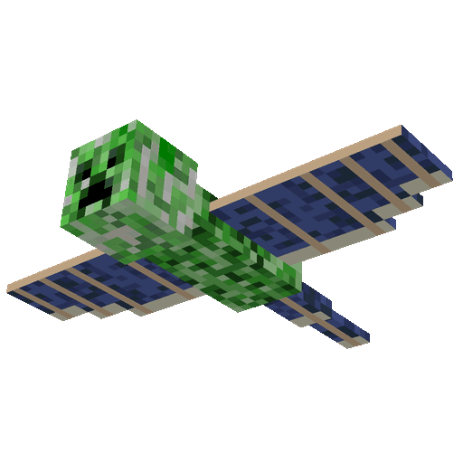
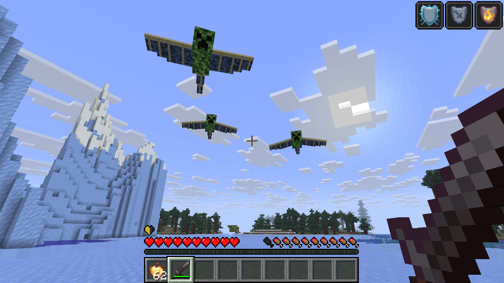
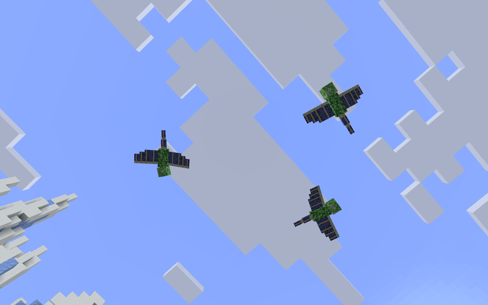
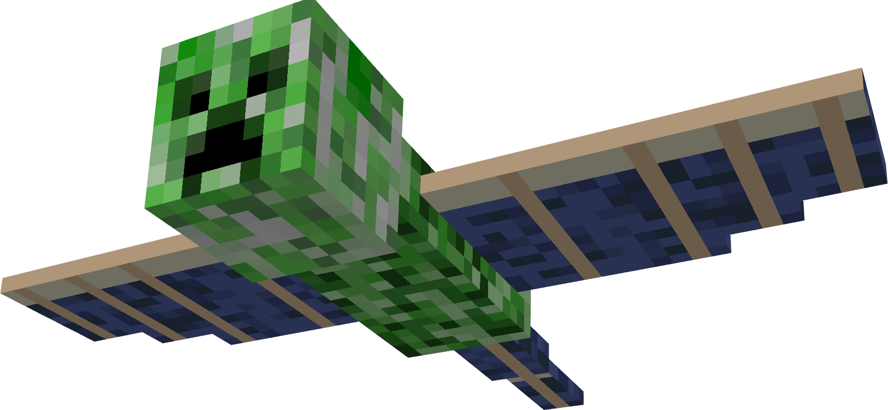

# PhantomCreeper / 幻翼苦力怕

<p align="center">
  
</p>

<p align="center">
  <a href="#兼容范围"></a>
  <a href="#兼容范围"></a>
  <a href="#兼容范围"></a>
  <a href="#兼容范围"></a>
  <a href="#兼容范围"></a>
  <a href="#兼容范围"></a>
  <a href="https://bstats.org/plugin/bukkit/PhantomCreeper/35223"></a>
  <a href="LICENSE"></a>
</p>

<p align="center"><a href="README.md">English</a> · <b>简体中文</b></p>

PhantomCreeper 是一个“幻翼 + 苦力怕”复合生物：像幻翼一样飞行，靠近玩家后像苦力怕一样点火爆炸。插件支持 Paper/Folia，可使用 BetterModel 或 ModelEngine 4.x 渲染模型。

<table align="center">
  <tr>
    <td align="center"></td>
    <td align="center"></td>
  </tr>
</table>

## 兼容范围

- 服务端：Paper 或 Folia 1.21.4～26.3
（已在 Paper26.3、Folia26.3 测试，其他版本未测试）
- Java：25
- 生物模型引擎（二选一）：
  - BetterModel 3.6.0 或更高（本项目参考版本为 3.7.0）
  - ModelEngine 4.1.1 或更高（Free 与 Premium 均可）
- 资源包托管：CraftEngine、ItemsAdder 或其他能合并模型引擎资源的插件

插件编译基线为 Paper API 1.21.4，因此当前发布包面向 Paper/Folia 1.21.4～26.3.x。

> 已知问题：目前在 ModelEngine 引擎下，模型飞行时会有轻微卡顿；BetterModel 下飞行流畅。该问题目前尚未修复。

## 命令

| 命令 | 说明 |
| --- | --- |
| `/phantomcreeper stats` | 查看自己的击杀与死亡统计 |
| `/phantomcreeper spawn [玩家]` | 在玩家前方 12 格、上方 6 格召唤 |
| `/phantomcreeper removeall` | 移除本插件管理的全部生物 |
| `/phantomcreeper reload` | 重载配置与语言文件 |
| `/phantomcreeper info` | 查看存活数量和模型状态 |
| `/phantomcreeper engine <bettermodel\|modelengine>` | 运行时切换已安装的模型引擎，并重新绑定现有生物 |

别名：`/pcreeper`

权限：

- `phantomcreeper.stats`：允许执行 `/phantomcreeper stats`，默认所有玩家可用。
- `phantomcreeper.admin`：允许 `spawn`、`removeall`、`reload`、`info`、`engine`，默认仅 OP。

`engine` 是管理员调试指令，只在对应模型引擎插件已安装时可用。切换不会修改 `config.yml`，服务器重启后仍按配置文件选择后端。

## PAPI 变量

| 变量 | 内容 |
| --- | --- |
| `%phantomcreeper_kills%` | 当前 PlaceholderAPI 玩家上下文中的玩家击杀数 |
| `%phantomcreeper_deaths%` | 当前 PlaceholderAPI 玩家上下文中的玩家被炸死次数 |

这两个变量都是按玩家统计。没有玩家上下文时返回 `0`。

## 完整配置说明

以下为完整的 `config.yml`，每项均附带中文注释：

```yaml
# PhantomCreeper / 幻翼苦力怕
# 修改模型设置后需重启服务器；其他配置可使用 /phantomcreeper reload。

# 插件语言：zh_cn（简体中文）或 en_us（英文）。
language: zh_cn

model:
  # 渲染后端：auto、bettermodel 或 modelengine。
  # auto 会优先使用 BetterModel，未安装时自动改用 ModelEngine。
  engine: auto
  # 两个模型引擎共用的模型名称，通常不需要修改。
  name: phantom_creeper
  # 模型整体缩放倍数。
  scale: 1.25
  # 飞行时循环播放的扇翼动画名称。
  flap-animation: flap
  # 使用 ModelEngine 时，将插件内置的兼容蓝图自动安装到
  # plugins/ModelEngine/blueprints/phantom_creeper.bbmodel。
  modelengine-auto-install-blueprint: true
  # 模型不可用时是否保留原版苦力怕载体作为可见兜底。
  keep-base-phantom-visible-if-model-fails: true

targeting:
  # 生物开始追踪玩家的最大距离。
  acquire-range: 48.0
  # 已有目标离开该距离后放弃追踪。
  lose-range: 64.0
  # 是否忽略创造模式玩家。
  ignore-creative: true
  # 是否忽略旁观模式玩家。
  ignore-spectator: true
  # 是否要求实体与玩家之间没有方块阻挡；开启会增加视线检测成本。
  require-line-of-sight: false

movement:
  # 远距离巡航速度，单位为格/tick；0.32 约为每秒 6.4 格。
  cruise-speed: 0.32
  # 近距离追击速度，单位为格/tick。
  chase-speed: 0.48
  # 所有飞行速度的硬上限。
  max-speed: 0.68
  # 速度变化平滑系数，范围 0.0～1.0；越大转向越快。
  acceleration: 0.20
  # 远距离巡航时保持在目标上方的高度。
  cruise-height: 6.0
  # 近距离俯冲时瞄准目标脚部以上的高度。
  strike-height: 1.2
  # 进入近距离攻击阶段和切换追击速度的距离。
  close-range: 8.0
  # 无目标时环绕巡逻点的半径。
  waypoint-radius: 3.5
  # 垂直飞行或返航时允许离开初始生成点的最大距离。
  max-distance-from-home: 72.0
  # 多个个体飞行时希望保持的避让距离；不会阻止同位置生成。
  minimum-separation: 6.0

combat:
  # 幻翼苦力怕的最大生命值。
  max-health: 24.0
  # 进入爆炸引信状态所需的玩家距离。
  trigger-radius: 2.8
  # 引信时长，20 tick 为 1 秒。
  fuse-ticks: 30
  # 玩家离开该距离后取消引信并恢复追击。
  fuse-cancel-radius: 7.0

  explosion:
    # 爆炸范围，单位为格；内部按该值计算 Minecraft 爆炸威力。
    radius: 6.0
    # 爆心原始伤害，在护甲、附魔和受伤无敌判定之前生效。
    damage: 40.0
    # 是否随距离线性降低伤害；关闭时范围内始终使用完整伤害。
    damage-falloff: true
    # 是否允许爆炸破坏方块，默认关闭。
    break-blocks: false
    # 爆炸后是否生成火焰。
    set-fire: false
    # 爆炸是否允许伤害幻翼苦力怕自身。
    damage-self: false

  # 被玩家击杀时掉落的幻翼膜数量。
  drop-phantom-membrane: 2
  # 被玩家击杀时掉落的火药数量。
  drop-gunpowder: 2
  # 被击杀时掉落的经验，至少为该值。
  dropped-experience: 20

natural-spawn:
  # 是否启用自然生成机制。
  enabled: true
  # 检查生成条件的间隔，20 tick 为 1 秒。
  check-interval-ticks: 200
  # Minecraft 夜晚开始时间。
  night-start-time: 13000
  # Minecraft 夜晚结束时间。
  night-end-time: 23000
  # 是否只在主世界执行自然生成。
  only-overworld: true
  # 自然生成个体存活上限；管理员指令生成不计入此上限。
  max-active: 10
  # 包括管理员生成在内的全部存活硬上限。
  max-tracked: 20

  spawn-area:
    # 生成点距离玩家水平方向的最小距离。
    min-distance: 18.0
    # 生成点距离玩家水平方向的最大距离。
    max-distance: 32.0
    # 生成点高于玩家的最小高度。
    min-height-offset: 6.0
    # 生成点高于玩家的最大高度。
    max-height-offset: 12.0

  # 机制 A：根据当前世界难度，每名玩家每个夜晚判定一次。
  nightly-difficulty-spawn:
    # 是否启用机制 A。
    enabled: true
    # 判定成功后一次生成的数量。
    spawn-count: 1
    chances:
      # Easy 难度触发概率；0.05 表示 5%。
      easy: 0.05
      # Normal 难度触发概率；0.10 表示 10%。
      normal: 0.10
      # Hard 难度触发概率；0.20 表示 20%。
      hard: 0.20

  # 机制 B：附近原版幻翼达到阈值时，每名玩家每个夜晚判定一次。
  phantom-threshold-spawn:
    # 是否启用机制 B。
    enabled: true
    # 统计原版幻翼数量的球体半径。
    scan-radius: 32.0
    triggers:
      # 附近有 3 只原版幻翼时生成 1 只幻翼苦力怕。
      - phantom-count: 3
        spawn-count: 1
      # 附近有 6 只原版幻翼时生成 2 只幻翼苦力怕。
      - phantom-count: 6
        spawn-count: 2

  # 允许自然生成的世界名。留空表示所有世界，但仍受 only-overworld 限制。
  worlds:
    - world

safety:
  # 区块卸载时是否立即移除插件管理的生物。
  remove-on-chunk-unload: true
  # 生物存活达到该 tick 数后自动移除；12000 tick 为 10 分钟，0 表示不自动移除。
  despawn-after-ticks: 12000
```

## 赞助与支持

如果本项目对你有帮助，可以通过 Ko-fi 或爱发电赞助开发。赞助后可提供插件安装、配置与故障排查等问答服务。

<div align="center">
  <a href="https://ko-fi.com/J5C529ZWWL" target="_blank"></a>
  <a href="https://afdian.com/a/sss000" target="_blank"></a>
</div>

<br><br><br>

<p align="center">
  
</p>